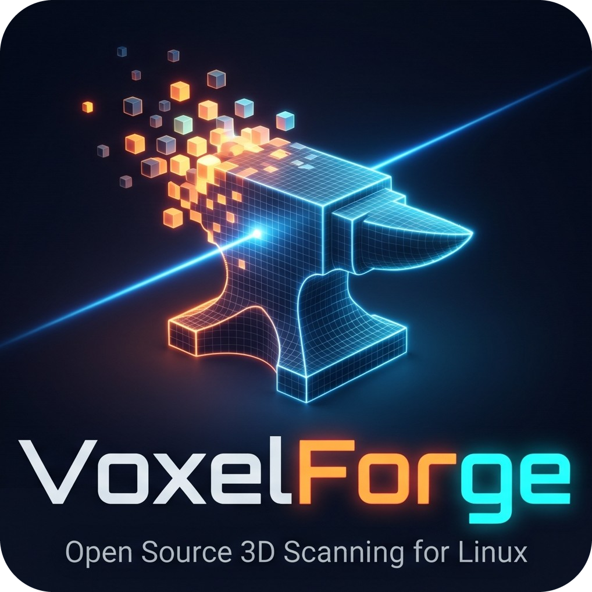

# VoxelForge



Native Linux-Anwendung für den Creality CR-Scan Otter (USB `2bc5:06da`). Sie benötigt weder Wine noch die Windows-DLLs.

## Installation
```
./install.sh
```
Benötigt: CMake, einen C++20-Compiler, OpenMP, libjpeg-turbo, GLFW und OpenGL 3.3. Beim ersten Build wird Dear ImGui geladen. Schrift und Symbole sind eingebaut.
Der Benutzer braucht Zugriff auf die Kamerageräte (Gruppe `video`).

## Bedienung
1. Scanner per USB 3 anschließen und `voxelforge` starten.
2. Objektgröße wählen: Klein (11–30 cm), Mittel (12–40 cm) oder Groß (18–120 cm). Die Leiste unten im Bild zeigt, ob der Abstand im grünen Bereich liegt.
3. Links wählen, was sich bewegt: Drehteller (Scanner steht still) oder Handbetrieb.
   Das Infrarotbild oben rechts zeigt die erkannten Marker. Mindestens 5 sollten sichtbar bleiben, der Teller gehört also ganz ins Bild.
   „Scan starten“ (Leertaste), langsam drehen oder umrunden, dann „Scan anhalten“. Hinweise wie „Langsamer drehen“ erscheinen oben links im Bild.
4. „Netz erstellen“ öffnet den Reiter „Mesh-Verarbeitung“. Dort bearbeiten und als STL, OBJ oder PLY speichern.

### Mehrere Scans
So bekommt ein Modell auch seine Unterseite.

1. Objekt scannen, „Neuer Scan“ wählen, Objekt umlegen und erneut scannen. Die Scans müssen sich überlappen, grob ein Drittel ist ein guter Wert.
2. **Ausrichten:** „Merkmale, Auto“ findet die Lage selbst, jeder Scan erscheint in einer eigenen Farbe. Liegen die Flächen richtig, zeigt sich ein feines Sprenkelmuster, größere einfarbige Versätze bedeuten eine falsche Lage. „Nächster Vorschlag“ hilft bei symmetrischen Objekten.
3. Geht das nicht, hilft **Manuell:** dieselbe Stelle abwechselnd in beiden Bildern anklicken, mindestens drei weit verteilte Paare. **Marker** taugt nur, wenn das Objekt zu den Markern gleich liegt, also nicht nach dem Umlegen auf dem Drehteller.
4. **Fusion** verschmilzt alle gewählten Scans zu einem Modell.

Beim Erstellen des Netzes werden alle Bilder am Modell fein ausgerichtet, Fläche entfernt, durch die eine Kamera hindurchgesehen hat, etwa Fetzen oder Stützen, und die Farbe aus den besten Ansichten genommen. Fehlen dadurch echte Teile, lässt sich das in den Netz-Einstellungen und im Fusion-Dialog abschalten. Im dunklen Raum bleibt das Modell ohne Farbe.

Der Ein-Klick-Prozess richtet offene Scans selbst aus, bricht aber mit einem Hinweis ab, wenn die Lage nicht eindeutig ist. Unter „Projektdatei“ lässt sich alles speichern und später mit anderen Werten neu berechnen. Die Dateien enthalten alle Bilder und können mehrere GB groß werden.

### Nachbearbeitung
Alles läuft über Vorschau, dann Bestätigen oder Abbrechen. Jeder Schritt lässt sich rückgängig machen.

- **Ein-Klick-Prozess:** führt alle Schritte nacheinander aus. Die Werte stehen im Dialog und werden gespeichert.
- **Lochfüllung, Auto:** füllt alle Löcher bis zum eingestellten Lochumfang. Die Öffnung an der Unterseite bleibt so offen, wenn der Wert darunter liegt.
- **Lochfüllung, Manuell:** Lochrand im Bild oder in der Liste anklicken (grün = klein, rot = groß), dann Vorschau. „Brücke bauen“ verbindet zwei Randkanten, das teilt ein großes Loch oder vereint zwei Löcher.
- **Typ:** Planar spannt straff, Tangente läuft in Richtung der Umgebung aus (meist die beste Wahl), Krümmung setzt auch die Wölbung fort und reagiert empfindlich auf unruhige Ränder.
- **Vereinfachen, Glätten, Bereinigen** (kleine Teile, Spitzen, Ränder), **Modell ausrichten** (automatisch, Fläche als Boden, Drehen), **Schnittebene** (größte Ebene, drei Punkte, waagerecht).
- **Auswahlleiste unter dem Modell:** Lasso, Rechteck, Objekt, Durchdringen, Umkehren, Aufheben, Löschen, Rückgängig, Wiederholen. Mit Strg wird abgewählt.
- **Maus:** Links drehen (in einem Auswahlwerkzeug Umschalt+Links oder Mitte), Rechts bewegen, Rad zoomen. Alle Tastenkürzel zeigt F1.
- **Schnellmessung:** zwei Punkte anklicken, Abstand in mm.
- Gespeicherte Dateien lassen sich links unter „Modell öffnen“ wieder laden.

Zahlen im Export sind Millimeter. Modelle stehen mit Z nach oben und der Unterseite bei Z = 0. Mit Markern gilt die Teller-Ebene als Boden.

## Stand
Vorhanden: Live-Tiefe, Tracking über Marker und Form, Drehteller-Modus, Objektwahl und Entfernen der Unterlage über Marker, Fusion, Netz, Export, Messwerkzeug (`voxelforge-cli messen`).
Farbe: Punktfarben im Netz, Export als PLY und OBJ mit Vertex-Farben. Dafür braucht jeder Scanner eine eigene Farbkalibrierung, die noch nicht über die Oberfläche erstellt werden kann.
Noch nicht vorhanden: Bearbeiten als Punktwolke vor der Fusion, Marker-Auswahl für die Schnittebene, Kalibrierfunktion in der Oberfläche, Textur-Atlas, Scanner-Tasten.
Bekannt: Bei 22 cm sind Außenmaße um rund 0,3–1,3 mm zu klein, nahezu unabhängig von der Objektgröße. Ursache offen.


## Start, Projekte und Einstellungen
- **Startseite:** die letzten Projekte mit Vorschaubild, neues Projekt, Projekt oder Modell öffnen.
- **Neues Projekt:** braucht Name und Speicherort. Es bekommt einen eigenen Unterordner `<Speicherort>/<Name>/`.
- **Einstellungen** (Zahnrad oben rechts): Standardspeicherpfad und Pfade zu den Slicern. Liegen in `~/.config/voxelforge/settings.ini`.
- **Scan-Bereich:** Ein geöffnetes Projekt zeigt die Punktwolke seines letzten Scans. Ein Klick auf einen Scan in der Liste zeigt dessen Punktwolke, „Neuer Scan“ führt zum Livebild.
- **Dateien:** Öffnen und Speichern laufen immer über einen Dateidialog (kdialog oder zenity, sonst ein eingebauter).
- **3D-Druck:** Das Modell öffnet sich mit einem Klick in Bambu Studio, PrusaSlicer oder OrcaSlicer. Gesucht wird im Programmpfad, unter Flatpak und nach AppImages.
- **Scanner-Haltung:** Quer oder hochkant. Das Livebild und die Richtung „oben“ des Modells drehen mit.

## Tipps für gute Scans
- Für feine Details „Klein“ und „Sehr fein“ wählen und **nah heran**, etwa 13–20 cm (der kräftig grüne Bereich der Abstandsleiste). Der Tiefenfehler wächst mit dem Quadrat des Abstands: Aus 30 cm kommt deutlich weniger Detail als aus 15 cm. Die Bildrate kann dabei sinken, langsam drehen.
- Glatte Formen wie Würfel oder Zylinder brauchen Marker auf der Unterlage.
- Für höchste Genauigkeit den Scanner rund 30 Minuten warmlaufen lassen (Empfehlung von Creality).

## Lizenz
Apache-2.0, siehe `LICENSE`. Schrift Inter (SIL OFL 1.1) und Symbole Lucide (ISC) liegen mit ihren Lizenzen unter `assets/fonts`. Dieses Repository enthält keine Dateien des Herstellers. „Creality“ und „CR-Scan“ sind Marken ihrer Inhaber, VoxelForge ist kein Produkt von Creality oder Orbbec.
