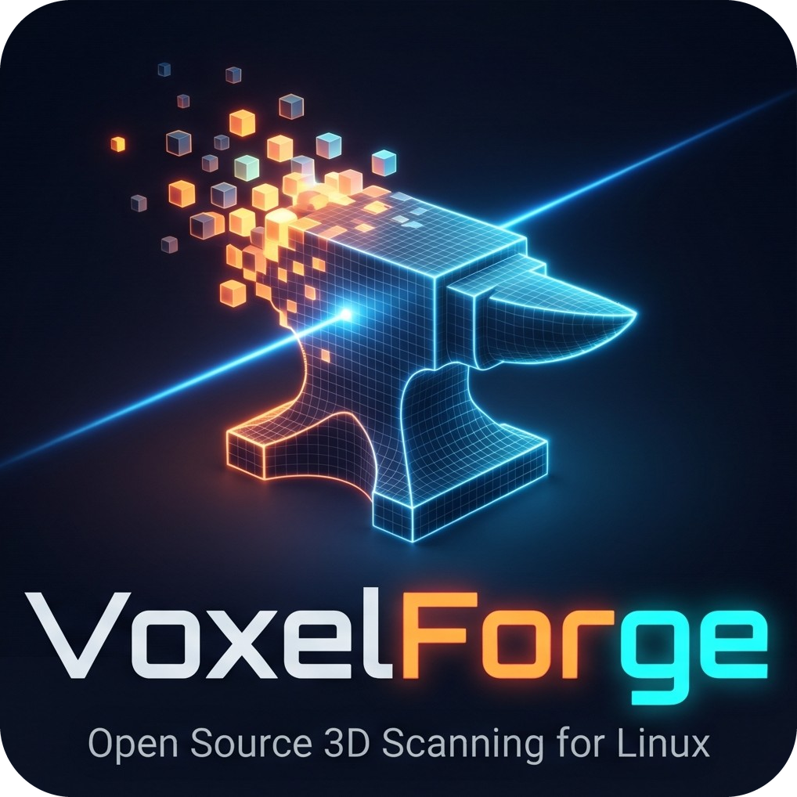
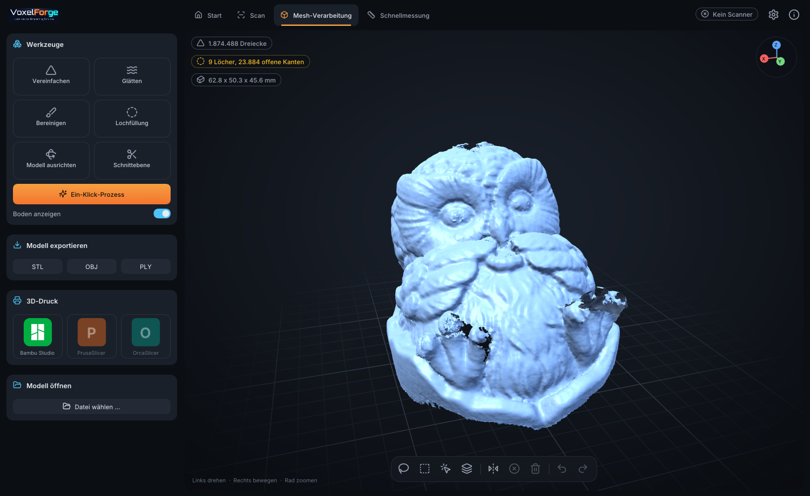

<p align="center"></p>

# VoxelForge

**Open source 3D scanning for Linux.** A native application for the Creality CR-Scan Otter, without Wine and without a cloud account: scan, align several scans, repair the mesh, and open the result in your slicer.

> The user interface is German in this release. English, French and Spanish are the next step and will follow the system language. See the [manual](docs/MANUAL.md) for what each German label means.



## Features

- **Live scanning** with a turntable or by hand, held level or upright, at the scanner's full 30 frames per second
- **Marker tracking** with a guide for the distance that gives the most detail
- **Several scans, one model:** automatic or manual alignment, fine alignment, and removal of stray points
- **Mesh tools:** one-click repair, hole filling with a choice of fill types, smoothing, simplifying, cut plane, measuring, undo
- **Export** to STL, OBJ and PLY, and one click to open a model in Bambu Studio, PrusaSlicer or OrcaSlicer
- **Runs on the graphics card where it pays off**, and checks the card against the CPU while it does. Without a suitable card the CPU does the work

Measured with this software on a 30 mm test cube scanned from about 18 cm: opposite faces 29.92 and 29.74 mm apart, at right angles within 0.25 degrees. Your results depend on the scanner, the distance and the object.

## Install

Download from the [releases page](https://github.com/HT686/VoxelForge/releases). All three are for x86-64 Linux with a CPU from about 2013 or newer (AVX2). The setup and the AppImage need glibc 2.35 or newer, which means distributions from 2022 on.

| Package | Best for | How |
|---|---|---|
| **Setup** | Most people | `sh VoxelForge-*-Setup-x86_64.sh` |
| **AppImage** | Trying it without installing | `chmod +x VoxelForge-*.AppImage && ./VoxelForge-*.AppImage` |
| **Flatpak** | Flatpak users | `flatpak install --user VoxelForge-*.flatpak` |

The setup adds the program to your application menu and installs the USB rule the scanner needs, for which it asks for your password once. `--no-usb-rule` skips that step, and `--uninstall` removes the program again. Your projects stay in place.

**AppImage and Flatpak cannot install the USB rule themselves.** Do this once, then plug the scanner in again:

```sh
curl -fsSL https://raw.githubusercontent.com/HT686/VoxelForge/main/packaging/99-voxelforge.rules | sudo tee /etc/udev/rules.d/99-voxelforge.rules
sudo udevadm control --reload-rules
```

Packages are tested on one system so far: CachyOS with KDE Plasma on Wayland, AMD graphics. Reports from other systems are welcome.

### Build from source

You need CMake, a C++20 compiler, OpenGL and EGL development files, GLFW 3.4 or newer, libturbojpeg, libpng and pkg-config.

```sh
git clone https://github.com/HT686/VoxelForge.git && cd VoxelForge
./install.sh          # builds and installs to ~/.local
```

## Quick start

1. Start VoxelForge and choose **Neues Projekt** (new project). Give it a name and a place.
2. Put the object in the middle of a turntable with markers. At least five markers should stay in view.
3. Keep the dot of the distance bar in the bright green range, about 13 to 20 cm for small objects. Closer gives much more detail.
4. Press **Scan starten** and turn the object slowly, one turn in about 15 seconds.
5. For the other sides, press **Neuer Scan**, lay the object on another side and scan again.
6. Press **Ausrichten** and then **Fusion** to join the scans.
7. Press **Ein-Klick-Prozess** to repair the model, then export it or open it in your slicer.

The [manual](docs/MANUAL.md) explains every step and setting.

## Project status

VoxelForge is young, and so far only the CR-Scan Otter (USB `2bc5:06da`) is supported. Color scans need a color calibration, for which there is no user interface yet.

## USE AT YOUR OWN RISK
This software is a Proof of Concept (PoC) implementation and is not a final product. It is intended solely for testing and evaluation purposes.
The software is provided "as is," without any warranty of any kind, express or implied. The authors and contributors assume no liability for any direct, indirect, incidental, or consequential damages, including but not limited to damage to systems, devices, hardware, or data loss arising from the use or inability to use this software.
By deploying or executing this software, you acknowledge and agree that you do so entirely at your own risk.

## License

[Apache-2.0](LICENSE). See [NOTICE](NOTICE) for third-party components. "Creality" and "CR-Scan" are trademarks of their owners. VoxelForge is an independent project, not affiliated with or endorsed by Creality or Orbbec.
