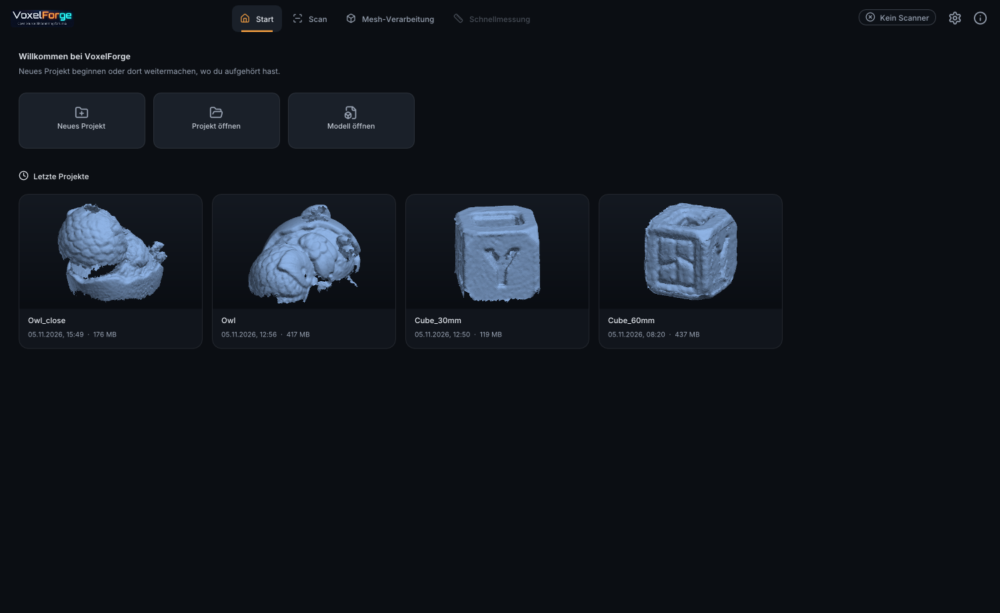
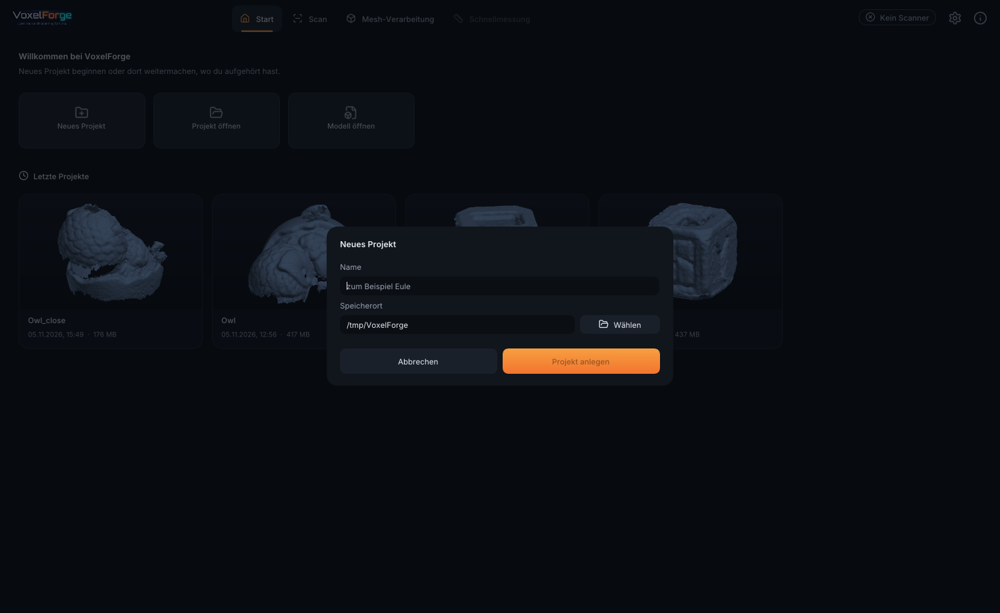
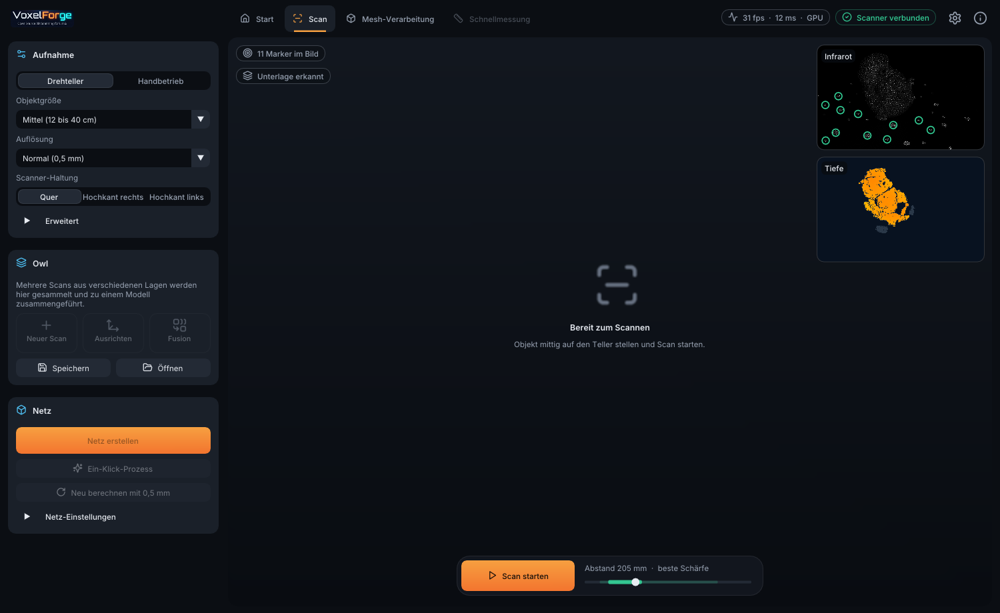
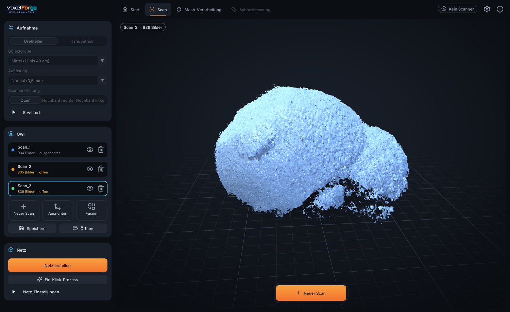
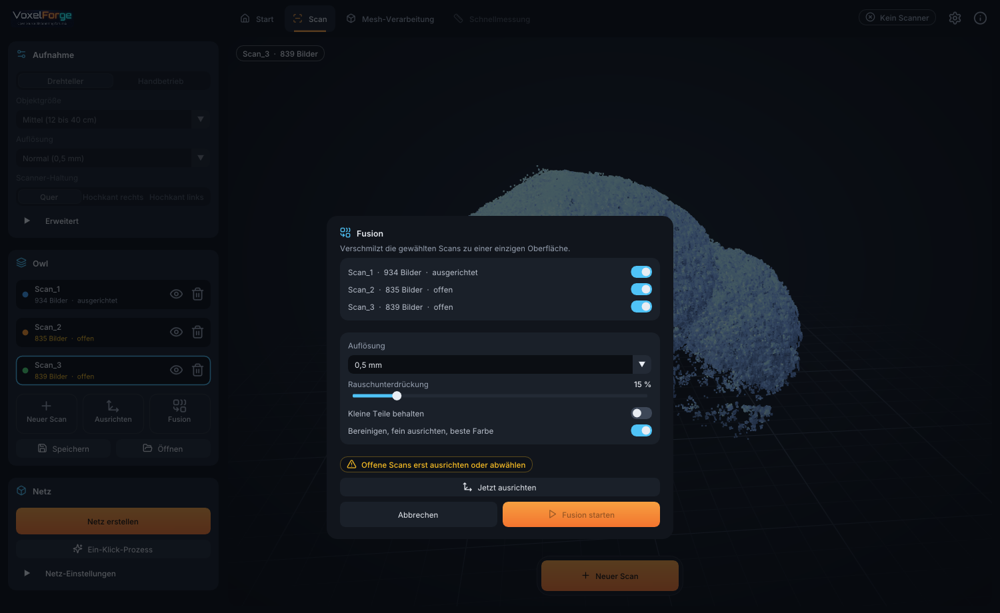
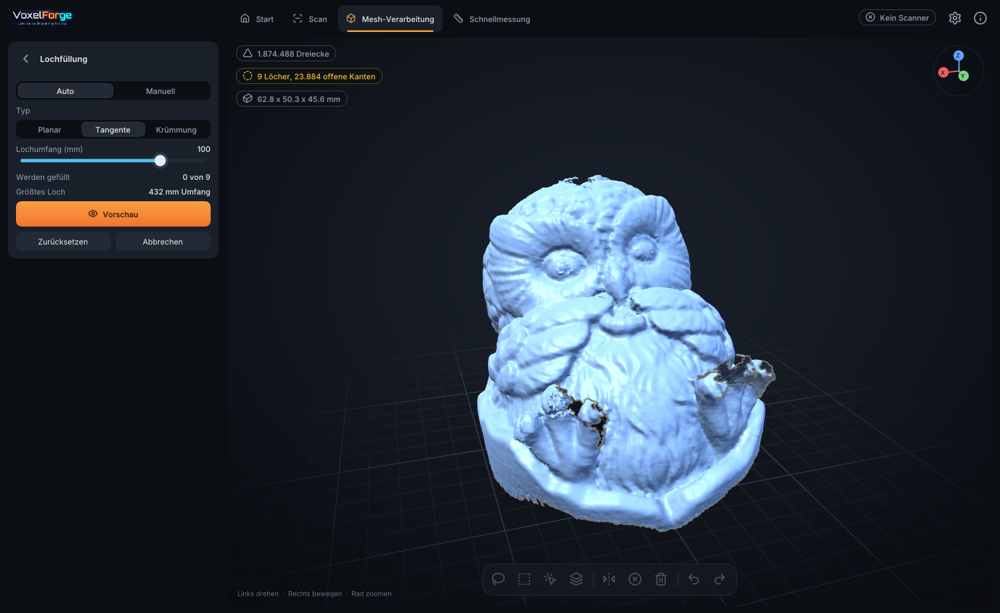
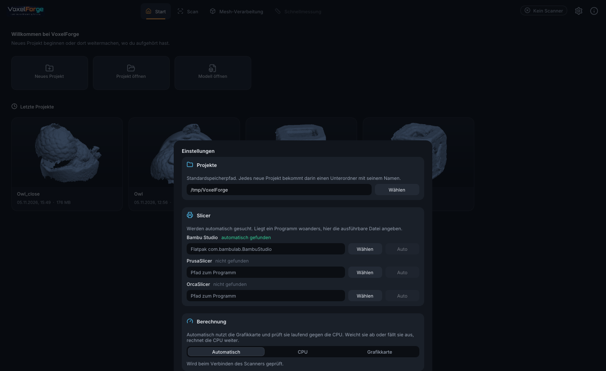

# VoxelForge manual

This manual follows the program from the start page to the finished print. The interface is German in this release, so each control is given with its German label and what it means.

## Contents

1. [Before you start](#before-you-start)
2. [Start page](#start-page)
3. [Scanning](#scanning)
4. [Several scans](#several-scans)
5. [Mesh tools](#mesh-tools)
6. [Export and 3D printing](#export-and-3d-printing)
7. [Measuring](#measuring)
8. [Settings](#settings)
9. [Keyboard and mouse](#keyboard-and-mouse)
10. [Troubleshooting](#troubleshooting)

## Before you start

**Scanner access.** Linux needs a USB rule before a normal user may talk to the scanner. The setup installs it. For AppImage and Flatpak, see the [README](../README.md#install).

**Warm-up.** Creality recommends letting the scanner warm up for about 30 minutes for the highest accuracy.

**Markers.** Round reflective markers on the surface under the object give the most reliable tracking. Smooth shapes such as cubes or cylinders need them.

## Start page

- **Neues Projekt** (new project) asks for a name and a place. The project gets its own folder named after it, inside the place you choose.
- **Projekt öffnen** (open project) and **Modell öffnen** (open model) open a file dialog. Models can be STL, OBJ or PLY.
- **Letzte Projekte** (recent projects) shows your projects with a picture. Older projects get their picture in the background. Click a card to open it. The **X** on a card takes it off this list and leaves its files untouched. Opening the project again brings it back.

## Scanning

### The capture card (Aufnahme)

| Label | Meaning |
|---|---|
| **Drehteller / Handbetrieb** | Turntable, or held in the hand |
| **Objektgröße** | Object size: small (11 to 30 cm), medium (12 to 40 cm), large (18 to 120 cm). This sets the working distance. |
| **Auflösung** | Resolution: very fine 0.15 mm, fine 0.25 mm, normal 0.5 mm, coarse 1 mm |
| **Scanner-Haltung** | How you hold the scanner: level (Quer) or upright (Hochkant), with its top leaning right (rechts) or left (links) as seen from behind. The live pictures and the model's up direction follow. |

**Erweitert** (advanced) holds three more settings:

- **Objektbereich** scales the area around the plate that counts as the object.
- **Unterlage entfernen** leaves the surface under the object out of the model.
- **Belichtung automatisch** sets the exposure from the dots on the object. Switch it off to set **Belichtung** by hand.

### The distance bar

The bar at the bottom of the view shows where the object is within the working range. The depth error grows with the square of the distance, so **distance matters more than any other setting**: 15 cm is almost four times as accurate as 30 cm.

- **Bright green:** the sharpest results, called **beste Schärfe**.
- **Pale green:** works, but with less detail. The bar suggests moving closer (**näher ran für mehr Detail**).
- **Amber:** too close (**zu nah**) or too far (**zu weit**).

For fine detail choose **Klein** and **Sehr fein**. Below about 13 cm little depth is left, so do not go closer than the green range.

### While scanning

Press **Scan starten** (start scan) or the space bar. The view shows the model as it grows, with the infrared (**Infrarot**) and depth (**Tiefe**) pictures in the corner. Green rings mark the markers found in the infrared picture.

Messages in the view tell you what to do:

| Message | Meaning |
|---|---|
| **Tracking gut** | All is well |
| **Position wird geprüft** | The markers suggest a position, and the surface has to confirm it |
| **Position verloren** | Tracking is lost. Go back to a part already scanned. |
| **Langsamer drehen** | Turning too fast |
| **Teller ganz ins Bild rücken** | Too few markers in view, bring the plate into the picture |

**Turn slowly**, about one turn in 15 seconds.

## Several scans

No single view sees an object from all sides. Scan it, lay it on another side, and scan again.

- **Neuer Scan** (new scan) stores the current scan in the project and returns to the live picture.
- Click a scan in the list to see its point cloud. An opened project starts with its last scan.
- The eye icon decides whether a scan is part of the model. The bin removes it.

### Aligning (Ausrichten)

The tool places the scans relative to each other.

- **Automatic** finds the position from the shape of the surfaces. They only need to overlap in part. A proposal marked as certain (**sicher**) is usually right. For symmetric objects several positions may fit, so you can step through them.
- **Markers** uses the marker layout, if the object did not move on the plate between scans.
- **Manual** lets you pick at least three matching points on both scans.

Always look at the result before accepting it.

### Fusion

**Fusion** joins the chosen scans into one surface. On a recent desktop, three scans at 0.15 mm take about half a minute.

- **Auflösung:** 0.15 mm suits small objects scanned from close up. A finer resolution from farther away adds noise, not detail.
- **Rauschunterdrückung** (noise suppression) ignores surface seen too rarely.
- **Bereinigen, fein ausrichten, beste Farbe** (clean up, fine-align, best color) is usually what you want. It aligns each frame finely, removes what a camera looked through, and takes color from the best views.

## Mesh tools

Each tool shows a preview that you accept or cancel. Everything can be undone.

| Tool | German label | What it does |
|---|---|---|
| Simplify | **Vereinfachen** | Reduces the number of triangles |
| Smooth | **Glätten** | Evens out the surface, optionally keeping edges |
| Clean up | **Bereinigen** | Removes small parts and spikes, smooths open rims |
| Fill holes | **Lochfüllung** | Fills holes up to a size, or those you pick. Types: flat (**Planar**), following the surface (**Tangente**), following its curvature (**Krümmung**) |
| Align model | **Modell ausrichten** | Turns the model and sets its base |
| Cut plane | **Schnittebene** | Cuts the model along a plane |

Under the view are tools to select with a lasso, a box or by part, and to delete what is selected.

**Ein-Klick-Prozess** (one-click process) runs the usual steps in order: remove small parts and spikes, smooth, fill holes, and close narrow seams. It leaves real openings of more than the set size alone. When **Wasserdicht** (watertight) appears, the model is closed.

## Export and 3D printing

- **Modell exportieren:** STL, OBJ or PLY, in a save dialog. OBJ and PLY keep color.
- **3D-Druck:** one click saves the model as `<project>_3d-druck.stl` next to the project and opens it in Bambu Studio, PrusaSlicer or OrcaSlicer. The buttons show the icon of the installed program. A slicer that was not found shows a letter and leads to the settings.

## Measuring

**Schnellmessung** (quick measurement): click two points to get their distance in millimeters. The size shown in the view is the smallest box around the model, however it is turned, and small stray pieces do not count.

## Settings

Open them with the gear icon at the top right.

- **Projekte:** the default folder for new projects.
- **Slicer:** VoxelForge looks in the usual places, including Flatpak and AppImages in `~/Applications`, `~/AppImages`, `~/.local/bin` and `~/Downloads`. If a program lies elsewhere, choose it with **Wählen**. **Auto** returns to searching.
- **Berechnung** (computation):
  - **Automatisch:** the graphics card, checked against the CPU on the first frames with a surface and every 1000 frames after. If it differs or fails, the CPU takes over.
  - **CPU:** always the processor.
  - **Grafikkarte:** the graphics card without that check.

Settings are in `~/.config/voxelforge/settings.ini`. For the Flatpak they are in `~/.var/app/io.github.ht686.VoxelForge/config/voxelforge/`.

## Keyboard and mouse

| Input | Action |
|---|---|
| Space | Start or stop scanning |
| 1, 2, 3 | Scan, mesh tools, quick measurement |
| Ctrl+Z, Ctrl+Y | Undo, redo |
| Delete | Delete the selection |
| Esc | Leave the selection tool |
| F1 | Help |
| Left mouse button | Rotate the view |
| Shift + left button | Rotate while a tool selects |
| Right mouse button | Move the view |
| Mouse wheel | Zoom |

## Troubleshooting

**"Kein Scanner" (no scanner).** Check the USB rule, plug the scanner in again, and make sure no other program uses it. For the Flatpak the rule has to be on the host system.

**The result looks soft.** Scan closer, in the bright green range, with **Sehr fein**. This is the most effective step.

**Tracking gets lost.** Keep at least five markers in view and turn more slowly.

**No distance or surface close up.** Below about 13 cm the scanner returns little depth. Move back a little.

**The model has no color.** Color needs enough light, and a color calibration for your scanner. Without enough light the model stays without color rather than showing false color.

**Status bar says CPU instead of GPU.** Your graphics card offers no OpenGL 4.3, or it failed the check. The reason is under **Berechnung** in the settings. Results stay the same, scanning is slower.

**Slicer does not open.** Choose its program file in the settings. Inside the Flatpak, VoxelForge starts programs on the host through `flatpak-spawn`.
